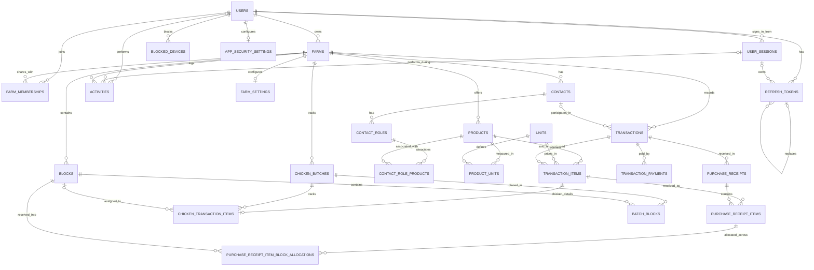

# FarmTrack Database Schema

This reference is based on the SQLAlchemy models currently registered in `app.models`. It describes the ORM model state, not a generated dump from the live database.

## Relationship Diagram

## Tables

### Identity and Security

- `users`: `id` PK; `email` unique; `password_hash`; `is_active`; `last_login_at` nullable; timestamps.
- `farm_memberships`: `id` PK; `farm_id` FK; `user_id` FK; `role` (`owner`, `manager`, or `worker`); `status` (`invited`, `active`, or `revoked`); nullable `invited_by_id` FK; `invited_at`; nullable `accepted_at` and `revoked_at`. Unique: (`farm_id`, `user_id`). Existing farm owners are backfilled as active `owner` memberships. Invited users must have an active FarmTrack account and accept the invitation before gaining access.
- `refresh_tokens`: `id` PK; `user_id` FK; nullable `session_id` FK; unique `token_hash`; `expires_at`; `revoked_at` nullable; `replaced_by_token_id` nullable self-FK; timestamps.
- `user_sessions`: `id` PK; `user_id` FK; hashed app-install `device_key`; device/platform/user-agent and network IP details; `created_at`; `last_seen_at`; nullable revocation time/reason.
- `blocked_devices`: `id` PK; `user_id` FK; hashed app-install `device_key`; device name; permanent flag or nullable block expiry; timestamps. This blocks a registered app installation ID, not an attested hardware identity.
- `app_security_settings`: `id` PK; unique `user_id` FK; `biometric_unlock_enable`; `passcode_enabled`; `auto_lock_enabled`; `auto_lock_minutes`; timestamps.

### Farm and Contacts

- `farms`: `id` PK; `owner_id` FK; `name`; nullable `description`, `location`, `phone_number`, `email`, `maximum_chicken_capacity`; `is_active`; timestamps. Unique per owner: (`owner_id`, `name`).

Farm membership roles are hierarchical for management, not for farm data
isolation: all active roles can access farm-scoped operations; managers can
also edit farm profile/settings and manage worker memberships; only owners can
delete a farm or grant/revoke manager access. Every farm-scoped API request
requires an active membership (or farm ownership).
- `farm_settings`: `id` PK; unique `farm_id` FK; nullable colors, font, font scale, logo, currency, timezone; `theme_mode`; timestamps.
- `contacts`: `id` PK; `farm_id` FK; `name`; nullable phone, email, address, notes; timestamps.
- `contact_roles`: `id` PK; `contact_id` FK; `role`; timestamps. Unique: (`contact_id`, `role`).
- `contact_role_products`: `id` PK; `contact_role_id` FK; `product_id` FK; `created_at`. Unique: (`contact_role_id`, `product_id`).

### Products, Units, and Stock

- `products`: `id` PK; `farm_id` FK; `name`; `product_type`; nullable `description`; `is_active`; timestamps.
- `units`: `id` PK; unique `name`; unique `abbreviation`; timestamps.
- `product_units`: `id` PK; `product_id` FK; `unit_id` FK; `conversion_factor`; `is_base_unit`; timestamps. Unique: (`product_id`, `unit_id`). A product has one base unit.
- `blocks`: `id` PK; `farm_id` FK; `name`; nullable `description`; `capacity`; `over_capacity_limit`; `is_active`; timestamps. Unique: (`farm_id`, `name`).
- `chicken_batches`: `id` PK; `farm_id` FK; `name`; `chicken_type`; nullable `breed`, `hatch_date`, `notes`; `status`; timestamps. Unique: (`farm_id`, `name`). Age at delivery is converted into `hatch_date`; `age` and `age_unit` are not stored. The model does not define `initial_quantity` or `acquisition_date`.
- `batch_blocks`: `id` PK; `batch_id` FK; `block_id` FK; `quantity`; timestamps. Unique: (`block_id`, `batch_id`). This is the batch-to-block inventory allocation.

### Transactions and Receipts

- `transactions`: `id` PK; `farm_id` FK; nullable `contact_id` FK; `transaction_type`; `status`; `transaction_date`; nullable `reference_number`, `notes`; timestamps.
- `transaction_items`: `id` PK; `transaction_id` FK; `product_id` FK; `unit_id` FK; nullable `chicken_type` snapshot; `quantity`; `conversion_factor`; `unit_price`; `total_amount`; nullable `notes`; timestamps. New chicken purchase items require a subtype; legacy null snapshots are filled from the explicitly selected batch on first receipt.
- `transaction_payments`: `id` PK; `transaction_id` FK; `amount`; `payment_date`; nullable `payment_time`; `payment_method`; nullable `reference_number`, `notes`; timestamps.
- `purchase_receipts`: `id` PK; `transaction_id` FK; `received_date`; nullable `received_time`, `notes`; timestamps. Each row is one delivery event against the original transaction.
- `purchase_receipt_items`: `id` PK; `purchase_receipt_id` FK; `transaction_item_id` FK; `quantity`; timestamps. Each row records how much of an original transaction item arrived in that delivery.
- `purchase_receipt_item_block_allocations`: `id` PK; `purchase_receipt_item_id` FK; `block_id` FK; positive `quantity`; `created_at`. This preserves the block split for each delivery independently of current inventory.
- `chicken_transaction_items`: `id` PK; unique `transaction_item_id` FK; `batch_id` FK; nullable `block_id` FK; `created_at`.

### Activity

- `activities`: `id` PK; `farm_id` FK; nullable `user_id` and `session_id` FKs; `type`; `entity_type`; `entity_id`; nullable JSONB `details`; `created_at`. `entity_id` is polymorphic and has no database FK. System/background activity may have no session.

## Enums

Values shown below are the Python/API enum values declared in `app.schemas.enums`.

| Enum                 | Values                                                                                                                                                                                                                                                                                                                                                                                                       |
| -------------------- | ------------------------------------------------------------------------------------------------------------------------------------------------------------------------------------------------------------------------------------------------------------------------------------------------------------------------------------------------------------------------------------------------------------ |
| `ContactRoleEnum`    | `customer`, `supplier`                                                                                                                                                                                                                                                                                                                                                                                       |
| `ThemeMode`          | `light`, `dark`, `system`                                                                                                                                                                                                                                                                                                                                                                                    |
| `ProductType`        | `eggs`, `chickens`, `feed`, `medication`, `equipment`, `other`                                                                                                                                                                                                                                                                                                                                               |
| `ChickenType`        | `layers`, `broiler`, `kienyeji`, `breeder`, `other`                                                                                                                                                                                                                                                                                                                                                          |
| `ChickenBatchStatus` | `active`, `completed`, `canceled`                                                                                                                                                                                                                                                                                                                                                                            |
| `TransactionType`    | `sale`, `purchase`                                                                                                                                                                                                                                                                                                                                                                                           |
| `TransactionStatus`  | `completed`, `cancelled`                                                                                                                                                                                                                                                                                                                                                                                     |
| `PaymentMethod`      | `cash`, `mpesa`, `bank_transfer`, `card`, `other`                                                                                                                                                                                                                                                                                                                                                            |
| `ActivityType`       | `farm_created`, `farm_updated`, `farm_deleted`, `farm_settings_updated`, `block_created`, `block_updated`, `block_deleted`, `contact_created`, `contact_updated`, `contact_deleted`, `contact_role_created`, `contact_role_updated`, `contact_role_deleted`, `contact_role_product_added`, `contact_role_product_removed`, `transaction_created`, `transaction_payment_recorded`, `purchase_receipt_created` |
| `ActivityEntityType` | `farm`, `block`, `contact`, `contact_role`, `contact_role_product`, `transaction`, `transaction_payment`, `purchase_receipt`                                                                                                                                                                                                                                                                                 |
| `AgeUnit`            | `days`, `weeks`, `months`, `years`                                                                                                                                                                                                                                                                                                                                                                           |

`AgeUnit` is currently declared but is not used by a mapped model field.
